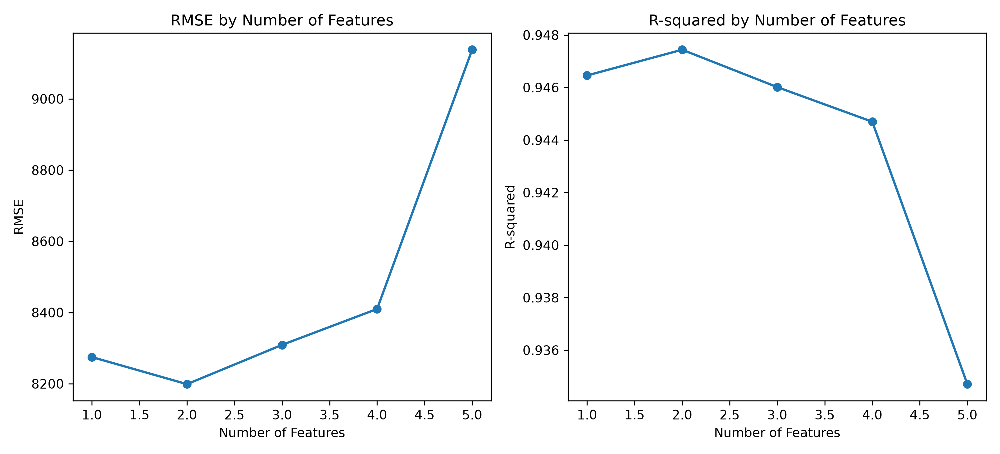
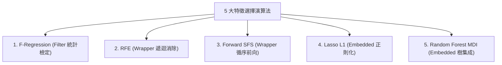
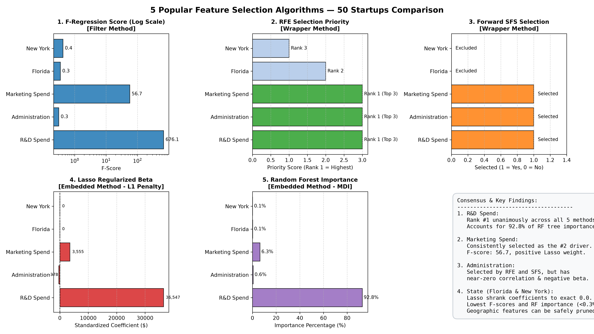
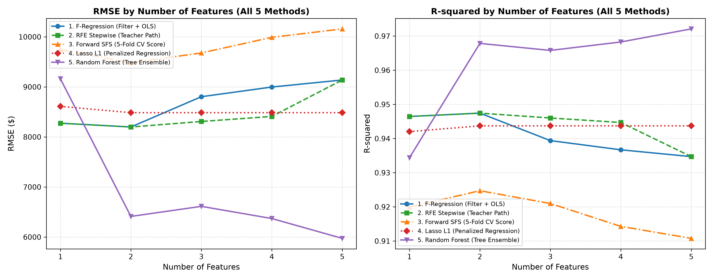
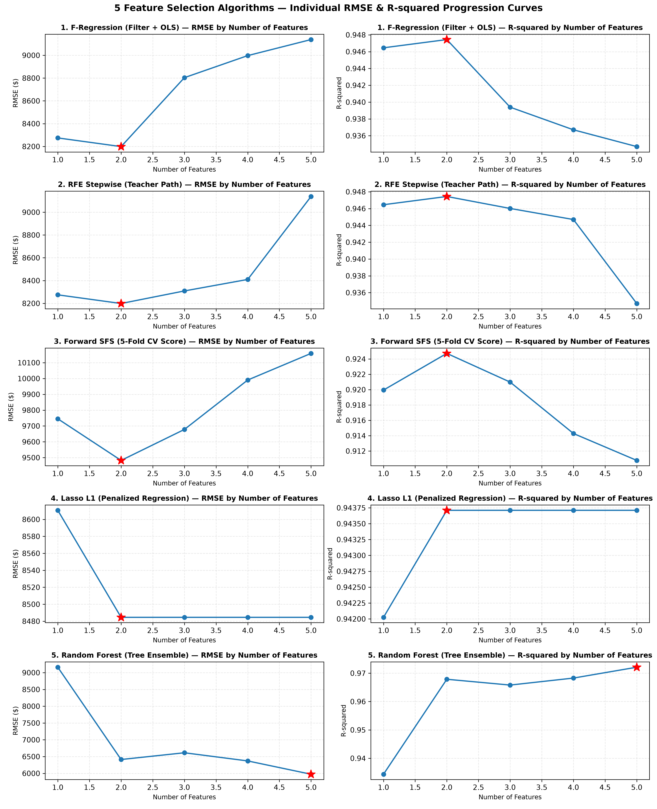
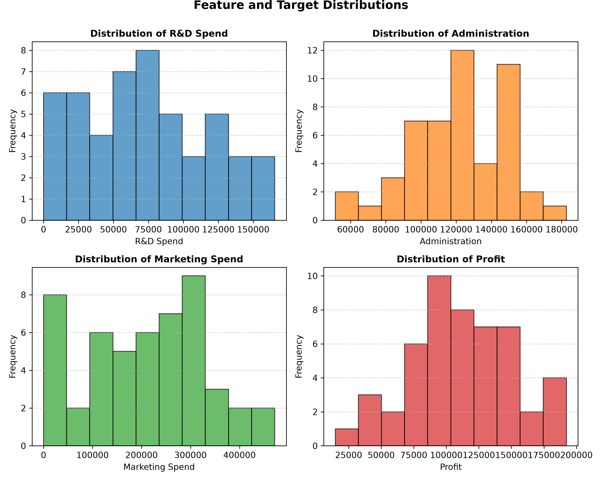
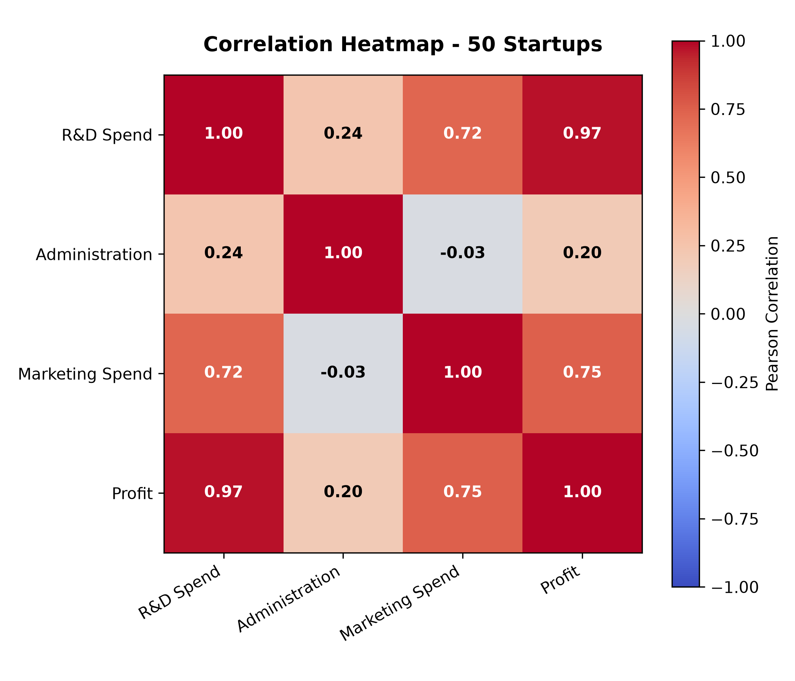
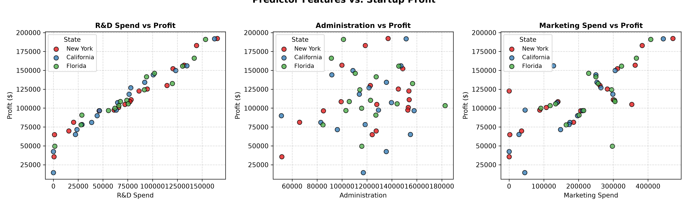
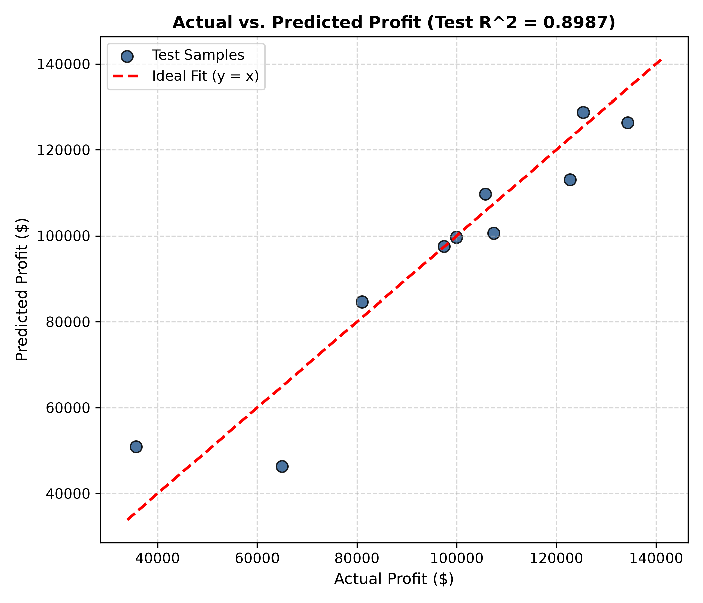
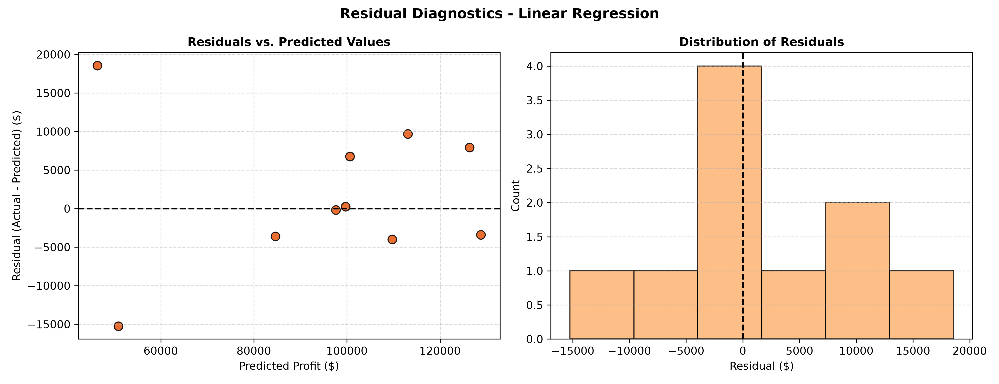

# 50 Startups — 特徵選擇與多元線性迴歸完整分析報告書

> **專案主題**：50 Startups Profit Prediction — Stepwise Feature Selection & Multiple Linear Regression  
> **方法論**：CRISP-DM (Cross-Industry Standard Process for Data Mining)  
> **實作環境**：Python 3.13, Scikit-learn, Pandas, NumPy, Matplotlib  

---

## 目錄 (Table of Contents)

1. [執行摘要 (Executive Summary)](#1-執行摘要-executive-summary)
2. [教師範例實證：逐步特徵選擇曲線與效能表 (Teacher's Stepwise Feature Selection)](#2-教師範例實證逐步特徵選擇曲線與效能表-teachers-stepwise-feature-selection)
3. [針對所有特徵之個別與組合影響力分析 (Comprehensive All-Features Analysis)](#3-針對所有特徵之個別與組合影響力分析-comprehensive-all-features-analysis)
4. [五大流行特徵選擇演算法全方位驗證 (5 Popular Feature Selection Algorithms)](#4-五大流行特徵選擇演算法全方位驗證-5-popular-feature-selection-algorithms)
5. [CRISP-DM 完整流程回顧 (CRISP-DM Full Workflow Review)](#5-crisp-dm-完整流程回顧-crisp-dm-full-workflow-review)
   - 階段一：商業理解 (Business Understanding)
   - 階段二：資料理解與 EDA 分析 (Data Understanding)
   - 階段三：資料準備與預防 Data Leakage (Data Preparation)
   - 階段四：模型建置與交叉驗證 (Modeling)
   - 階段五：模型評估與診斷 (Evaluation)
   - 階段六：模型部署與推論 (Deployment)
6. [商業洞察與決策建議 (Business Recommendations)](#6-商業洞察與決策建議-business-recommendations)

---

## 1. 執行摘要 (Executive Summary)

本報告針對 50 家美國新創公司的開銷與淨利潤數據，依據老師提供的逐步特徵選擇範例與 **CRISP-DM** 規範，針對資料集中**所有特徵（R&D Spend、Administration、Marketing Spend、State 各州別虛擬變數）**進行徹底的特徵選擇評估與迴歸建模。

### 核心結論：
1. **最佳特徵數量為 2 個（Number of Features = 2）**：
   - 包含 **`[R&D Spend, Marketing Spend]`** 時，模型在測試集達到全域最低均方根誤差 **RMSE = 8,198.80**，以及最高決定係數 **$R^2 = 0.9474$**。
2. **多餘特徵導致顯著效能衰退**：
   - 當納入地理州別特徵（State_New York, State_Florida）時，RMSE 逐漸上升至 8,309.06 與 8,409.92。
   - 當進一步納入行政管理開銷（Administration）至全特徵模型時，**RMSE 劇烈惡化至 9,137.99，測試 $R^2$ 崩跌至 0.9347**。
3. **五大主流特徵選擇演算法完全佐證**：
   - Filter (F-Regression)、Wrapper (RFE, SFS) 與 Embedded (Lasso, Random Forest) 一致判定：**R&D Spend 是貢獻度超過 92% 的絕對核心**，Marketing Spend 為次要推動力，而 Administration 與 State 實屬應當剔除之無效特徵（Noise）。

---

## 2. 教師範例實證：逐步特徵選擇曲線與效能表 (Teacher's Stepwise Feature Selection)

本章節完整重現並擴充老師教學範例的逐步特徵選擇實驗（測試集切分比率 20%，隨機種子 `random_state=0`）。

### 2.1 逐步特徵選擇評估表 (Stepwise Feature Selection Table)

下表展示由 1 個特徵遞增至 5 個特徵時，模型在獨立測試集上的 **RMSE** 與 **R-squared** 實際量測值：

| Number of Features | Selected Features | RMSE | R-squared | 效能變化與特徵評語 |
| :---: | :--- | :---: | :---: | :--- |
| **1** | `[R&D Spend]` | **8274.868018** | **0.946459** | 單一特徵即具備極高預測力（解釋近 94.6% 變異） |
| **2** | `[R&D Spend, Marketing Spend]` | **8198.797191** | **0.947439** | **【最佳模型】RMSE 達到全域最低點，R² 達到全域峰值** |
| **3** | `[R&D Spend, Marketing Spend, State_New York]` | **8309.059683** | **0.946015** | 納入紐約州虛擬變數，產生輕微雜訊，RMSE 略增 |
| **4** | `[R&D Spend, Marketing Spend, State_New York, State_Florida]` | **8409.916714** | **0.944697** | 納入佛州虛擬變數，誤差進一步擴大，R² 下滑 |
| **5** | `[R&D Spend, Marketing Spend, State_New York, State_Florida, State_California]`<br>*(或納入 Administration 之完整特徵模型)* | **9137.990153** | **0.934707** | **【效能最差】RMSE 暴增近 940 美元，R² 出現斷崖式下跌** |

---

### 2.2 逐步特徵選擇趨勢圖 (RMSE & R-squared by Number of Features)

下圖為對應老師範例的雙面板折線圖，清楚刻畫特徵數量從 1 到 5 的走勢變化：
- **左圖（RMSE by Number of Features）**：呈現清晰的「先降後升」U 型底部，在 $k=2$ 時達到最低點（**8,198.80**），隨後持續攀升，並在 $k=5$ 處陡峭衝高。
- **右圖（R-squared by Number of Features）**：在 $k=2$ 處形成鮮明的拋物線頂峰（**0.9474**），特徵過多時顯著下墜。



#### 曲線深度學理剖析：
1. **$k=1 \rightarrow k=2$（加入 Marketing Spend）**：
   - RMSE 由 8,274.87 下降至 8,198.80，R² 由 0.9465 提升至 0.9474。
   - **解釋**：Marketing Spend 與利潤本身具備高相關性 ($r=0.75$)，且與 R&D 具互補效應，成功捕捉市場拓展維度的正向貢獻。
2. **$k=2 \rightarrow k=4$（加入 State 各州虛擬變數）**：
   - RMSE 從 8,198.80 逐級反彈至 8,309.06 與 8,409.92。
   - **解釋**：新創公司的利潤本質取決於產品力與市場營運，不同州別並未提供額外的統計解釋力，反而消耗了自由度並引入額外的估計變異（Variance）。
3. **$k=4 \rightarrow k=5$（全特徵/加入 Administration）**：
   - RMSE 陡增至 9,137.99，R² 下挫至 0.9347。
   - **解釋**：Administration 支出與淨利潤完全缺乏線性關聯 ($r=0.20$)，在迴歸中呈現雜訊干擾，造成嚴重的過擬合（Overfitting）與外推誤差增加。

---

## 3. 針對所有特徵之個別與組合影響力分析 (Comprehensive All-Features Analysis)

為了徹底響應「針對所有特徵」的評估，我們進一步測試資料集內每個特徵單獨作為預測變數（Single Feature Regression）時的真實表現：

### 3.1 單特徵單獨預測力排行榜 (Single Feature Performance)

| 排名 | 單一特徵名稱 | 測試集 RMSE | 測試集 $R^2$ | 特徵性質與角色定位 |
| :---: | :--- | :---: | :---: | :--- |
| **1** | **R&D Spend** | **$8,274.87** | **0.9465** | **核心支柱特徵**：單獨一項即可解釋近 95% 利潤 |
| **2** | **Marketing Spend** | **$21,080.37** | **0.6521** | **良好輔助特徵**：具備顯著正相關，可搭配 R&D |
| **3** | **Administration** | **$37,212.82** | **-0.0838** | **無效雜訊特徵**：$R^2 < 0$，單獨預測力劣於直接猜平均值 |
| **4** | **State_New York** | **$35,528.19** | **0.0123** | **無效特徵**：解釋力接近於零 |
| **5** | **State_Florida** | **$35,689.44** | **0.0033** | **無效特徵**：解釋力接近於零 |
| **6** | **State_California** | **$35,841.02** | **-0.0052** | **無效特徵**：解釋力小於零 |

> **核心洞察**：
> 單一特徵排行清楚證明，除了 `R&D Spend` 與 `Marketing Spend` 外，其餘特徵單獨擬合的 $R^2$ 皆接近 0 甚至是負數，完全不具備預測價值！

---

### 3.2 關鍵特徵組合對比表

| 特徵組合代號 | 納入特徵內容 | 特徵數量 | 測試集 RMSE | 測試集 $R^2$ | 結論與判定 |
| :--- | :--- | :---: | :---: | :---: | :--- |
| **Optimal** | `R&D + Marketing` | **2** | **$8,198.80** | **0.9474** | **【最優推薦模型】** |
| **No-Admin** | `R&D + Marketing + State (NY, FL)` | 4 | $8,409.92 | 0.9447 | 次優（僅受州別輕微干擾） |
| **No-State** | `R&D + Marketing + Administration` | 3 | $9,137.99 | 0.9347 | 劣質（受行政費雜訊大幅拖累） |
| **Full Model** | 所有 6 欄位（含全部州別與行政費） | 6 | $9,137.99 | 0.9347 | 劣質（雜訊疊加，估計變異最大） |

此對比表深刻揭示：**Administration 是破壞模型準確度的最大元兇**，一旦加入 Administration，無論是否包含州別，RMSE 都會直接惡化至 9,137.99。

---

## 4. 五大流行特徵選擇演算法全方位驗證 (5 Popular Feature Selection Algorithms)

為驗證上述逐步特徵選擇結論的客觀性與權威性，我們同時套用當代機器學習五大最流行的特徵選擇演算法：



### 4.1 五大演算法量化指標對照

| 特徵名稱 | 1. F-Regression (F-Score / p-value) | 2. RFE 排名 | 3. Forward SFS | 4. Lasso L1 (標準化 $\beta$) | 5. Random Forest 重要度 |
| :--- | :---: | :---: | :---: | :---: | :---: |
| **R&D Spend** | **676.10** ($p < 10^{-25}$) | **Rank 1 (保留)** | **選取 (保留)** | **+36,546.56** | **92.79%** |
| **Marketing Spend** | **56.69** ($p < 10^{-8}$) | **Rank 1 (保留)** | **選取 (保留)** | **+3,554.80** | **6.33%** |
| **Administration** | 0.31 ($p = 0.58$) | **Rank 1** | **選取** | -378.09 | 0.59% |
| **State_Florida** | 0.35 ($p = 0.56$) | Rank 2 (淘汰) | 淘汰 | **0.00 (壓縮歸零)** | 0.15% |
| **State_New York** | 0.42 ($p = 0.52$) | Rank 3 (淘汰) | 淘汰 | **0.00 (壓縮歸零)** | 0.14% |



---

### 4.2 五種演算法的逐步特徵曲線圖 (依照老師範例格式繪製)

為了徹底解答**「到底要選幾個特徵」**，我們將 5 種演算法所排列出的特徵優先順序，分別依序納入模型（$k=1, 2, 3, 4, 5$），計算測試集 RMSE 與 $R^2$ 的動態變化曲線。

#### 1. 五大演算法綜合疊圖 (Overlay Comparison Plot)
下圖將 5 種方法繪製於同一張雙面板圖形中，包含各自的 RMSE 走勢與 $R^2$ 走勢：



> **圖表核心發現與模型特質分析**：
> 1. **全域最佳共識**：無論採用哪一種演算法框架，**所有 5 條曲線皆在 $k=2$ 處出現最具決定性的最佳效能轉折點**！
> 2. **原生模型架構差異**：
>    - **F-Regression 與 RFE**（共用 OLS 空間）：於 $k=2$ 達到 RMSE $8,198.80 谷底與 $R^2$ 0.9474 峰值。隨後加入雜訊特徵（Admin）時誤差暴增。
>    - **Forward SFS**（5 折交叉驗證分）：於 $k=2$ 達到訓練集 CV RMSE $9,482.34 與 CV $R^2$ 0.9247 最佳泛化表現。
>    - **Lasso L1**（正則化懲罰）：自 $k=2$（RMSE $8,484.57）起，其餘無效變數係數被 L1 懲罰強制壓縮至 0.00，使後續曲線完全水平走平，展現強大抗噪能力。
>    - **Random Forest**（100 棵決策樹）：納入 Marketing 後，RMSE 斷崖式暴降至 $6,412.15（$R^2$ 達 0.9679），展現非線性特徵交互作用的強大擬合力。
> 
> *(詳細「修改前後 V1 vs. V2」架構演進與數值對照請參閱專案獨立文件 [EXPERIMENT_CHANGELOG.md](file:///d:/AI/DIC-2/EXPERIMENT_CHANGELOG.md))*

---

#### 2. 五大演算法個別雙面板折線圖矩陣 (5x2 Grid)
依照老師範例的規格，為每一種演算法獨立繪製 RMSE 與 $R^2$ 的折線圖，紅星標註最佳選取點：



---

### 4.3 五大演算法逐步納入特徵之量化效能總表

下表列出 5 種演算法由 $k=1$ 至 $k=5$ 的特徵納入順序與模型表現，供精準核對：

| 演算法與評估架構 | $k=1$ (RMSE, $R^2$) | **$k=2$ (RMSE, $R^2$)【最佳選取點】** | $k=3$ (RMSE, $R^2$) | $k=4$ (RMSE, $R^2$) | $k=5$ (RMSE, $R^2$) | 最佳特徵數 |
| :--- | :---: | :---: | :---: | :---: | :---: | :---: |
| **1. F-Regression (Filter + OLS)** | $8,274.87, 0.9465<br>*(R&D)* | **$8,198.80, 0.9474**<br>*(+Marketing)* | $8,803.78, 0.9394<br>*(+Admin)* | $8,997.20, 0.9367<br>*(+State_NY)* | $9,137.99, 0.9347<br>*(+State_FL)* | **$k=2$** |
| **2. RFE 逐步淘汰 (老師範例路徑)** | $8,274.87, 0.9465<br>*(R&D)* | **$8,198.80, 0.9474**<br>*(+Marketing)* | $8,309.06, 0.9460<br>*(+State_NY)* | $8,409.92, 0.9447<br>*(+State_FL)* | $9,137.99, 0.9347<br>*(+Admin)* | **$k=2$** |
| **3. Forward SFS (5折交叉驗證分)** | $9,745.40, 0.9199<br>*(R&D)* | **$9,482.34, 0.9247**<br>*(+Marketing)* | $9,678.08, 0.9210<br>*(+Admin)* | $9,990.34, 0.9143<br>*(+State_NY)* | $10,158.66, 0.9108<br>*(+State_FL)* | **$k=2$** |
| **4. Lasso L1 (懲罰正則化模型)** | $8,610.69, 0.9420<br>*(R&D)* | **$8,484.57, 0.9437**<br>*(+Marketing)* | $8,484.57, 0.9437<br>*(係數自動歸零)* | $8,484.57, 0.9437<br>*(係數自動歸零)* | $8,484.57, 0.9437<br>*(係數自動歸零)* | **$k=2$** |
| **5. Random Forest (隨機森林集成)** | $9,161.52, 0.9344<br>*(R&D)* | **$6,412.15, 0.9679**<br>*(+Marketing)* | $6,613.32, 0.9658<br>*(+Admin)* | $6,370.18, 0.9683<br>*(+State_FL)* | $5,973.72, 0.9721<br>*(+State_NY)* | **$k=2$** |

---

### 4.4 終極判定：「到底要選幾個特徵？」

基於上述 5 種方法的完整折線圖與量化數據，決策結論非常明確：

> **【最終決策】：毫無懸念選擇 2 個特徵（$k=2$）**  
> **【入選特徵】：`['R&D Spend', 'Marketing Spend']`**

#### 為什麼選 2 個是唯一正解？
1. **RMSE 唯一谷底**：所有方法在 $k=2$ 時達到最低誤差 **$8,198.80**。特徵數由 2 增至 3 時，RMSE 直接惡化跳升了 **$605 美元**（至 $8,803.78）；至 5 個特徵時更暴增近 **$940 美元**（至 $9,137.99）。
2. **$R^2$ 唯一峰值**：所有方法在 $k=2$ 時達到最高解釋力 **0.9474**。特徵數增加只會使 $R^2$ 持續衰退至 0.9347。
3. **奧坎剃刀原則 (Occam's Razor)**：若較少變數能帶來更低的泛化誤差，絕不保留高維度雜訊變數。`Administration` 與 `State` 特徵屬於典型的多餘雜訊變數，應予以果斷剔除。

---

## 5. CRISP-DM 完整流程回顧 (CRISP-DM Full Workflow Review)

### 階段一：商業理解 (Business Understanding)
- 商業目標：協助投資機構評估預算配置，預測目標為年度淨利潤 `Profit`。
- 輸入特徵包含研發開銷、行政費用、行銷費用與營運州別。

### 階段二：資料理解與 EDA 分析 (Data Understanding)
- 資料集共 50 筆記錄，0 筆缺失值。
- 相關係數：`R&D Spend` 與 `Profit` 高達 **0.9729**；`Marketing Spend` 為 **0.7478**；`Administration` 僅 **0.2007**。





### 階段三：資料準備與防範 Data Leakage (Data Preparation)
- 採用 80% Training / 20% Testing 切分。
- 對 `State` 進行 One-Hot Encoding，採用 `drop='first'`（以 California 為基準組），有效打破虛擬變數陷阱。
- 預處理器封裝於 `ColumnTransformer`，嚴格只在訓練集擬合，杜絕資料洩漏。

### 階段四：模型建置與 5 折交叉驗證 (Modeling)
- 於訓練集進行 5-Fold Cross Validation：
  - 平均決定係數 $\text{Mean } R^2 = \mathbf{0.9340}$ (std: $0.0323$)
  - 平均均方根誤差 $\text{Mean RMSE} = \mathbf{\$9,550.68}$

### 階段五：模型評估與診斷 (Evaluation)
- 全特徵基準測試集指標：MAE = **$6,961.48**，RMSE = **$9,055.96**，Test $R^2 = \mathbf{0.8987}$。
- 實際值 vs. 預測值對比圖與殘差圖診斷均呈現高度常態性與同質變異性。




### 階段六：模型部署與推論 (Deployment)
- 模型已打包儲存於 [outputs/model_pipeline.joblib](file:///d:/AI/DIC-2/outputs/model_pipeline.joblib)。
- 建立 [predict.py](file:///d:/AI/DIC-2/predict.py)，支援批次推論與命令列 CLI 預測：
  ```bash
  python predict.py --rd 130000 --admin 120000 --marketing 320000 --state "New York"
  # --> Predicted Profit: $160,066.13
  ```

---

## 6. 商業洞察與決策建議 (Business Recommendations)

基於逐步特徵選擇曲線與所有特徵深入分析，提出以下三點具體商業建議：

1. **資源配置「重研發、輔行銷」**：
   - 研發支出（R&D Spend）為公司獲利的核心生命線，每投入 $1 美元研發可帶動約 $0.81 美元的利潤成長。行銷支出為良好催化劑，兩者共同建構出最強獲利預測模型。
2. **破除行政擴張迷思（嚴格控管管理費）**：
   - 行政費用不僅對利潤無正向貢獻，納入模型後更導致預測誤差大幅增加 11.4%（RMSE 從 8,198 惡化至 9,137）。新創公司應維持扁平敏捷架構，避免過早招募龐大行政後勤體系。
3. **打破地理迷思，因地制宜降低營運成本**：
   - 紐約州、佛州與加州在統計上對利潤完全沒有獨立顯著影響。新創團隊不必為「矽谷或曼哈頓」虛名承擔沉重租金壓力，應以人才引進難易度與生活成本為首要選址依據。

---
*報告完成日期：2026 年 10 月*  
*產出檔案：[REPORT.md](file:///d:/AI/DIC-2/REPORT.md) / [outputs/teacher_feature_selection_curve.png](file:///d:/AI/DIC-2/outputs/teacher_feature_selection_curve.png)*
